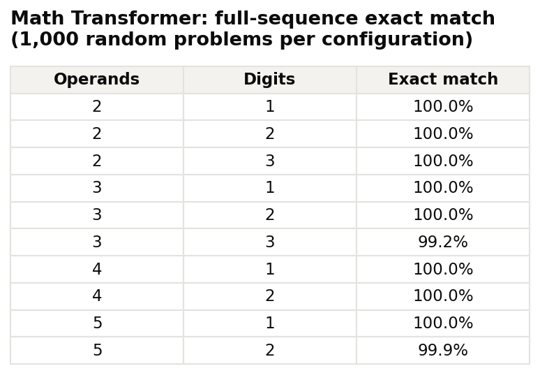
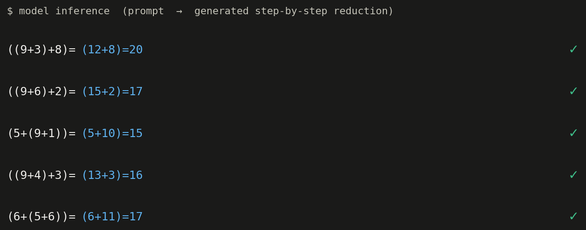
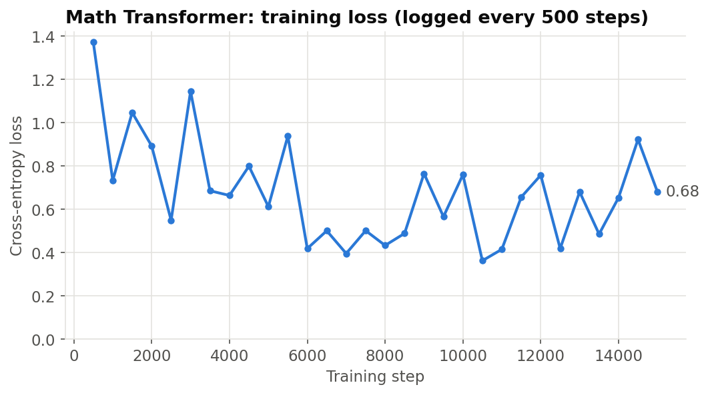
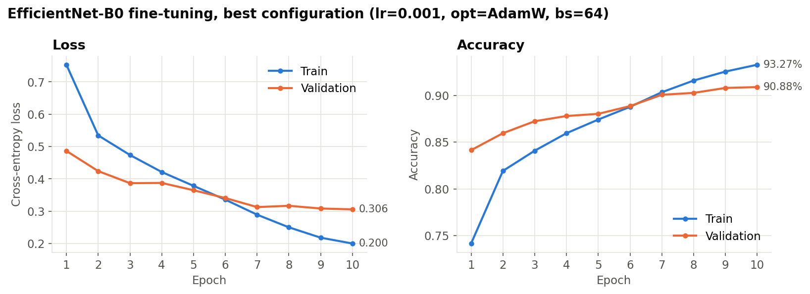
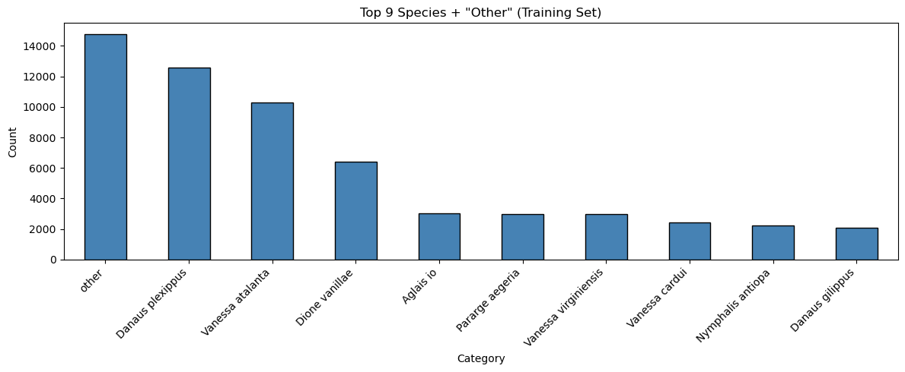
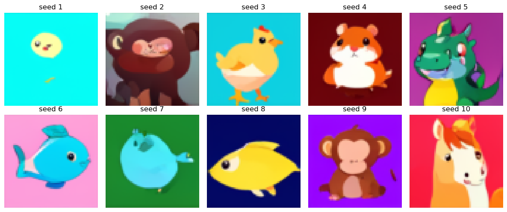
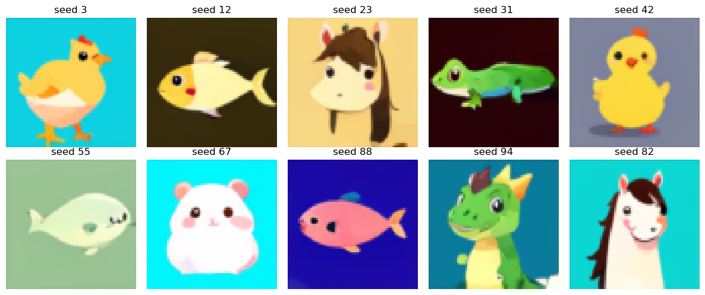
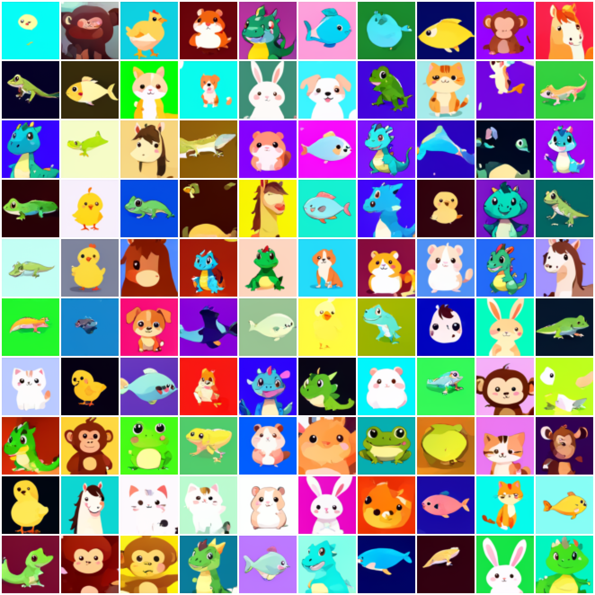
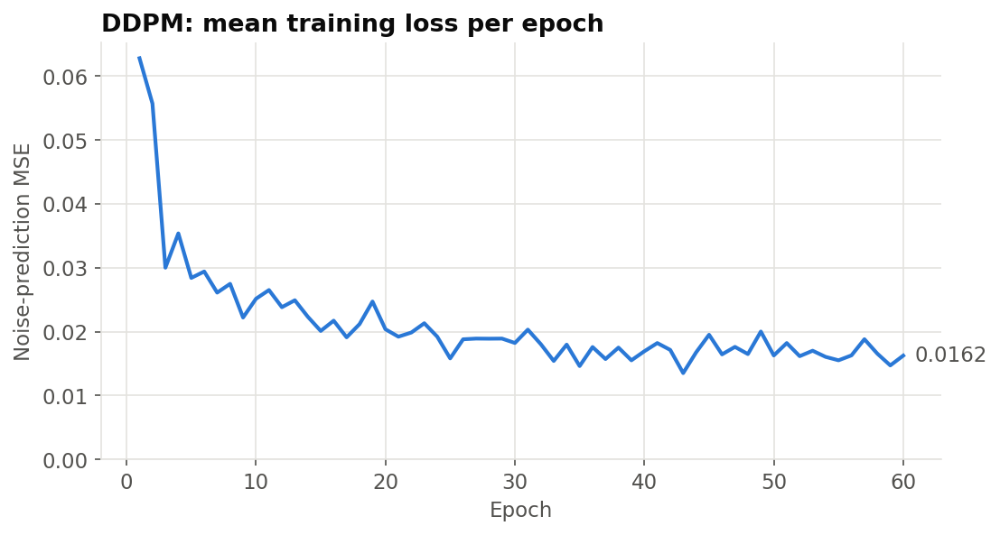

# DS 542 Deep Learning: Project Results

Course projects · DS 542 Deep Learning · Boston University · Spring 2026 · Grade: A

> Code and written reports are not published in accordance with the course's academic-integrity policy. This repository shows results only.

All models were trained on GPUs on Boston University's Shared Computing Cluster (SCC).

| Project | Model | Headline result |
| --- | --- | --- |
| [Math Expression Transformer](#1-math-expression-transformer) | Decoder-only Transformer, ~3.2M parameters, trained from scratch | 99.2%–100% full-sequence exact match across 10 test configurations |
| [Butterfly Species Classification](#2-butterfly-species-classification) | EfficientNet-B0, transfer learning | 90.88% validation accuracy (10 classes) |
| [Diffusion Image Generation](#3-diffusion-image-generation-ddpm) | DDPM with a U-Net denoiser | 60 epochs on 22,000 64×64 images, fp16 mixed precision |

---

## 1. Math Expression Transformer

**Goal.** Teach a language model to simplify nested addition expressions one reduction at a time, writing out every intermediate step, e.g. `((9+3)+8)= (12+8)=20`. The model has to keep working as expressions get longer and numbers get larger.

**Approach.** I trained a decoder-only Transformer from scratch at the character level, using a 17-token vocabulary (digits, `+`, `(`, `)`, `=` and special tokens). It has learned token and positional embeddings, followed by stacked causal self-attention blocks. I trained it on freshly generated problems for 15,000 steps with AdamW and a cosine learning-rate schedule. At test time the model gets only the expression up to `=` and decodes the rest greedily, one token at a time.

**Key numbers**

- ~3.2M parameters (3,204,113): 6 layers, 8 attention heads, d_model = 256
- Evaluation: 1,000 random problems per configuration, counted correct only if the **whole** generated sequence matches exactly
- **99.2%–100%** exact match on all 10 configurations (2–5 operands, 1–3 digits per operand)

  

  

  

---

## 2. Butterfly Species Classification

**Goal.** Classify iNaturalist butterfly photos into the 9 most frequent species plus an "other" class that covers the remaining 166 species. The dataset is heavily imbalanced: the largest class is about seven times the size of the smallest.

**Approach.** I fine-tuned an ImageNet-pretrained EfficientNet-B0 end to end and replaced its classifier with a dropout plus linear head for the 10 classes. Training used random resized crops, horizontal flips and colour jitter as augmentation. I ran a grid search over learning rate, optimizer (AdamW vs. SGD) and batch size, training each run for 10 epochs with cosine annealing and keeping the checkpoint with the best validation accuracy.

**Key numbers**

- Training set: 59,751 images (175 species, grouped into 10 classes); validation set: 10,000 images
- **90.88% validation accuracy**, best configuration: AdamW, lr = 1e-3, batch size 64
- ~4.0M parameters

  

  

---

## 3. Diffusion Image Generation (DDPM)

**Goal.** Train a denoising diffusion probabilistic model from scratch that generates 64×64 cartoon-style animal images.

**Approach.** The denoiser is a U-Net with six resolution levels and self-attention at a low-resolution level, trained to predict the noise added at each of 1,000 diffusion timesteps. I trained it for 60 epochs with AdamW and fp16 mixed precision to fit the GPU memory and time budget. Images are produced by running the full 1,000-step reverse process from fixed random seeds, so every result can be reproduced exactly.

**Key numbers**

- 22,000 training images at 64×64
- 60 epochs (~20.6k optimizer steps), batch size 64, fp16 mixed precision
- Mean noise-prediction loss fell from ~0.063 in the first epoch to ~0.016 in the last

**Samples from fixed seeds 1–10**

  

**Hand-picked favourites**

  

<b>All 100 fixed-seed samples</b>

  

  

---

## 中文说明

这里收录的是 2026 年春季 BU DS 542 深度学习课程三个项目的训练结果（成绩 A）。按课程学术诚信要求，只展示结果，不公开代码和报告。

- **数学表达式 Transformer**：从零训练的 decoder-only 模型（约 320 万参数，6 层、8 头、d_model 256），按步骤化简嵌套加法。在 10 组"操作数个数 × 位数"的配置上，每组测 1,000 题，整条序列完全正确的比例为 99.2%–100%。
- **蝴蝶物种分类**：用 ImageNet 预训练的 EfficientNet-B0 做迁移学习，分为 9 个常见物种和"其他"共 10 类。训练集 59,751 张。经过超参数网格搜索，验证集准确率最高为 90.88%。
- **DDPM 扩散模型**：以 U-Net 为去噪网络，在 22,000 张 64×64 图片上用 fp16 混合精度训练 60 轮。生成时用固定随机种子，结果可以完全复现。

所有模型都在 BU SCC GPU 集群上训练。
